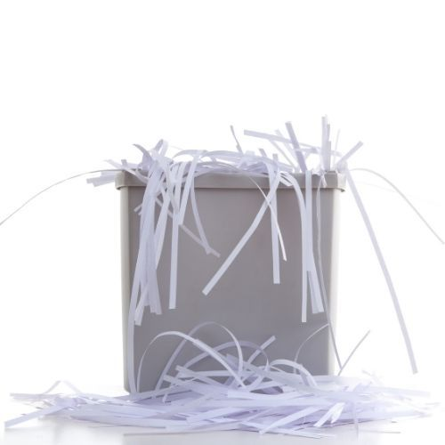
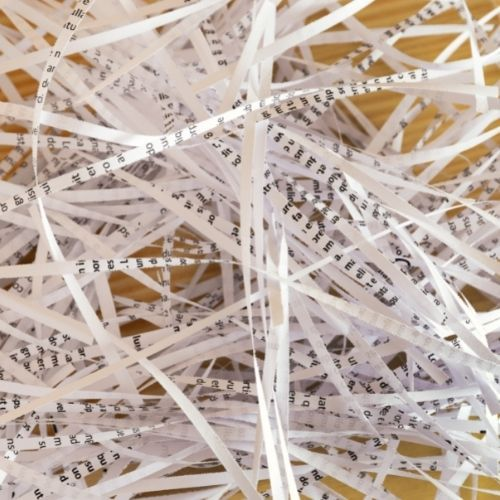

## Destrucción de documentos confidencial

**¿Necesitas sacarte del medio mucha documentación confidencial y no sabes a donde acudir?**

En trasteros Vigo, por medio de un convenio de colaboración, **podremos realizarte ese arduo trabajo de destruir miles y miles de documentos de papel** que encuentras en tu oficina.

## ¿Que tipo de documentos destruimos?

Documentos de papel como planos, dibujos, informes y folletos. También realizamos destrucción de algunos soportes digitales como tarjetas, sims, cintas digitales, disquetes, tarjetas lectoras de chips, componentes de los ordenadores, CDs, DVDs. Ponte en contacto con nosotros si no esta en tu lista lo que deseas destruir.

## ¿Como realizamos el servicio de destrucción de papel ?

-   **Asesoramiento y formalización** . Estudiamos tus requerimientos
-   **Suministro de contenedor/es o Recogida Puntual**. Suministros contenedores para su llenado de documentación.
-   **Recogida**. Recogemos el/los contenedor/es para traerlos a nuestras instalaciones.
-   **Destrucción**. Ya con la documentación en nuestras instalaciones, la misma la echamos en las maquinar destructoras para su destrucción.
-   **Generación de Certificado y reciclaje**. Con la documentación confidencial ya destruido generamos el certificado oficial para enviar al cliente. Posteriormente lo reciclamos.

Este servicio lo llevaría a cabo nuestra empresa colaboradora:

**[grupodixital.es](https://grupodixital.es)**

## Otros servicios que podrían interesarte
